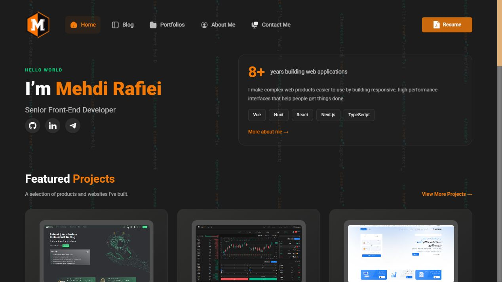

# MehdiSpace — Personal Portfolio

The source code for [MehdiSpace](https://mehdispace.com), my personal website and portfolio. It brings together selected client work, project galleries, front-end articles, and information about my experience.

## Homepage preview



## What’s included

- Responsive homepage and project portfolio with image galleries
- Project detail pages with media previews and technology summaries
- Blog with article pages and syntax-highlighted code samples
- About, contact, and résumé sections
- Page transitions, carousels, and interactive UI components

## Tech stack

- **Framework:** Nuxt 3 and Vue 3
- **Styling:** UnoCSS with utility-first classes and custom CSS
- **State:** Pinia
- **Animation:** GSAP
- **Carousels:** Swiper and Vue 3 Carousel
- **Code highlighting:** highlight.js
- **Icons:** nuxt-svgo

## Run locally

Use Node.js and npm, then install the dependencies and start the Nuxt development server:

```bash
npm install
npm run dev
```

To create a production build:

```bash
npm run build
```
